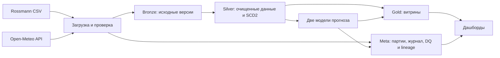

# Rossmann Forecast

Прогноз дневной выручки магазинов Rossmann на 42 дня и контроль обработки данных: от загрузки источников до моделей и дашбордов.

## Запуск

Нужны Docker Desktop и Docker Compose v2. Исходные CSV уже находятся в `data/`. При первом запуске потребуется интернет для скачивания образов и получения погоды. Рекомендуется 6–8 ГБ свободной оперативной памяти.

```bash
cp .env.example .env
make up
make run
```

Интерфейс: **http://localhost:8501**. После остановки данные и прогнозы сохраняются в томе PostgreSQL. Для повторного открытия системы достаточно запустить Docker Desktop и выполнить `make up`.

Первичная загрузка миллиона строк и обучение занимают десятки минут. Повторный запуск пропускает обработанные партии и одинаковый расчёт моделей.

| Команда | Действие |
|---|---|
| `make up` | Собрать и запустить PostgreSQL и интерфейс |
| `make run` | Загрузить данные, проверить качество, обучить модели и опубликовать прогноз |
| `make test` | Выполнить автоматические проверки |
| `make demo` | Проверить повтор загрузки, карантин, журнал ошибок, SCD2 и блокировку публикации |
| `make scheduled` | Включить повтор pipeline по расписанию |
| `make logs` | Показать последние логи контейнеров |
| `make down` | Остановить контейнеры с сохранением данных |

PostgreSQL доступен на `localhost:55432`. Демонстрационные настройки подключения находятся в `.env.example`; переопределения задаются в `.env`.

## Данные

- [Rossmann Store Sales](https://www.kaggle.com/competitions/rossmann-store-sales/data): продажи за 2013–2015 годы, справочник 1115 магазинов и будущие плановые факторы. `train.csv` содержит 1 017 209 строк. В `test.csv` нет целевого показателя Sales.
- [Open-Meteo Historical Weather API](https://open-meteo.com/en/docs/historical-weather-api): дневная температура и осадки. Параметры запроса, время получения и полный ответ сохраняются локально в `data/weather_cache/`.
- `store_geo_mapping.csv`: фиксированная синтетическая геопривязка. Она используется для демонстрации объединения источников и не описывает реальные адреса магазинов. Погода и география не входят в признаки моделей.

Система работает в режиме исторического replay. По умолчанию логическая дата — `2015-07-31`, горизонт — 42 дня. Это прогноз выручки магазина; товарные остатки и продажи по SKU в исходном наборе отсутствуют.

## Архитектура



Хранение — PostgreSQL 16, обработка — Python и pandas, модели — scikit-learn, интерфейс — Streamlit и Plotly. Полный pipeline запускается через CLI; для расписания предусмотрен отдельный сервис scheduler.

CSV обрабатывается месячными порциями с SHA-256 и журналом партий. Повтор одной версии не создаёт дубли; исправления обновляют Silver через UPSERT. API догружает недостающие интервалы, обрабатывает таймауты и ограничение частоты запросов. Порция и её manifest сохраняются атомарно, а ошибка запуска — отдельной транзакцией.

Проверки качества охватывают полноту, уникальность, допустимость значений, типы, диапазоны, ссылочную целостность и актуальность. Некорректные строки попадают в карантин. Критические нарушения Silver блокируют публикацию нового прогноза. Актуальность в replay проверяется относительно логической даты.

Историзация магазинов использует SCD2 с интервалами `[valid_from, valid_to)`. Каталог и граф lineage связывают показатели с преобразованиями и источниками. Для модели сохраняются исходные партии, снимок обучающих данных, код, параметры и версии библиотек.

## Прогнозирование

Сравниваются **Seasonal Naive** с недельной сезонностью и **HistGradientBoosting** на `log1p(Sales)`. Оценка проводится на трёх последовательных окнах по 42 дня с расширяющейся обучающей историей; последнее окно — финальный holdout.

Признаки бустинга: календарь, плановые факторы, лаги продаж 42/49/56/364 дня и скользящие средние, заканчивающиеся на `target_date − 42`. Лаги считаются по календарю с учётом пропущенных дат. Будущее число покупателей и фактическая погода исключены. Нулевые продажи сохраняются.

Метрики: MAE, WAPE и RMSPE на строках с `actual > 0`. Результаты доступны по окнам, магазинам, форматам и неделям горизонта. Open, Promo и праздники в backtest считаются известным планом. Для будущих магазинов без плана используется подписанный календарный сценарий.

Предметный дашборд показывает прогноз, backtest, сравнение моделей и экспорт CSV. Операционный — свежесть, загрузки, DQ, карантин и ошибки. Данные панелей обновляются каждые 30 секунд.

## Структура проекта

```text
pas/                  загрузки, качество, SCD2, метаданные, ML и CLI
sql/migrations/       актуальные миграции PostgreSQL
dashboard/app.py      интерфейс
tests/                unit, интеграционные и UI-проверки
data/                 исходные CSV и локальный кеш API
artifacts/            результаты запусков и модели; не хранится в Git
scripts/              первоначальные загрузчики и проверка браузера
```

Первоначальные `scripts/load_*.py`, `scripts/loader.py`, `scripts/generate_geo.py` и `sql/*.sql` сохранены как ранний этап разработки. Актуальные точки входа — `pas.cli` и Make; схема новой базы создаётся миграциями из `sql/migrations/`.

## Дополнительные команды

```bash
# Журнал последних запусков
docker compose run --rm app python -m pas.cli status

# Работа без API после первичного получения кеша
docker compose run --rm app python -m pas.cli run --weather-mode offline

# Явный новый эксперимент
docker compose run --rm app python -m pas.cli forecast --force

# Пошаговая загрузка на отдельной пустой базе
docker compose run --rm app python -m pas.cli ingest --as-of 2015-06-30
docker compose run --rm app python -m pas.cli ingest --as-of 2015-07-31
```

Replay ведётся вперёд. Для проверки более раннего периода после полной загрузки нужна отдельная база. Исторические исправления погоды и изменения SCD2 задним числом требуют управляемого backfill. Отсутствие строки в новой версии источника не трактуется как удаление.

## Разработка и проверки

Для запуска Python локально используется версия 3.11; PostgreSQL можно оставить в Docker:

```bash
docker compose up -d db
python3.11 -m venv .venv
.venv/bin/python -m pip install -r requirements.txt
.venv/bin/python -m pas.cli run
.venv/bin/streamlit run dashboard/app.py
```

Unit-проверки без БД:

```bash
.venv/bin/python -m pytest tests/test_core.py tests/test_cache.py -q
```

Полный набор проверок запускается через `make test` после `make run`. Он включает временную доступность признаков, календарные лаги, обработку дефектов, повторную загрузку, исправление источника, SCD2 и страницы интерфейса. Интеграционный сценарий создаёт отдельную временную базу и удаляет её после проверки. В CI выполняются unit-тесты.

Настройки: `DATABASE_URL`, `AS_OF`, `HORIZON=42`, `SEED`, `MODEL_ITERATIONS`, `WEATHER_MODE=auto|live|offline`, `INTERVAL_SECONDS`. Секреты, кеш и сгенерированные результаты не включаются в репозиторий.
